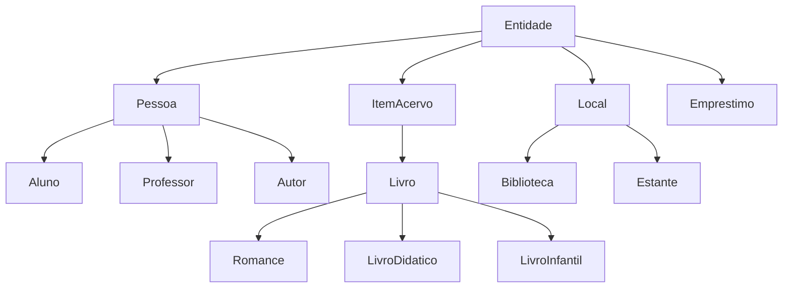

# Mini-Projeto 03 — Biblioteca escolar

**Autor:** Gabriel Rafá Martins Freire  
**Matrícula:** 20230145310  
**Modalidade:** individual  
**Tecnologias:** Python, RDFLib, RDF, RDFS, OWL, Turtle e SPARQL

## 1. Resumo e escolha do tema

Uma base de conhecimento de biblioteca escolar que responde perguntas simples: quais livros existem, quem os escreveu, onde ficam habitualmente, quem os pegou emprestados e quais empréstimos estão vencidos no cenário.

O tema foi escolhido por ser familiar e fácil de explicar. Este é um projeto novo, independente dos projetos anteriores de Sekiro; não utiliza Experta nem lógica fuzzy.

**Todos os nomes, títulos e registros do cadastro são fictícios e plausíveis, criados para fins didáticos.** Não há dados pessoais de usuários reais nem livros reais com autoria inventada. O objetivo é demonstrar modelagem e consultas, sem acrescentar fatos apenas para atingir contagens.

Cada `Livro` representa um **exemplar físico** identificado por código de inventário. Um registro `Emprestimo` trata de um exemplar e uma pessoa. `guardadoEm` indica a estante de guarda habitual, não a posição física atual de um exemplar emprestado. As datas são fixas, e a consulta de vencidos usa **03/11/2026** para continuar reproduzível depois desse dia.

## 2. Arquivos e execução

| Arquivo | Papel |
|---|---|
| `biblioteca.ttl` | Base completa: esquema e indivíduos em Turtle |
| `consultas.py` | Aplicação que carrega o `.ttl` e executa todas as consultas |
| `requirements.txt` | Dependências com versões fixadas |
| `Mini_Projeto_03_Biblioteca.ipynb` | Notebook autossuficiente, explicado e com resultados de execução |
| `saida_execucao.txt` | Saída real da aplicação |
| `ROTEIRO_APRESENTACAO.md` | Orientações de apresentação e perguntas prováveis |
| `README.md` | Modelagem, consultas, execução e conferência do roteiro |

### Terminal — Fedora/Linux/macOS

Use Python 3.12, como no ambiente validado. Extraia o ZIP e abra o terminal na pasta que contém `consultas.py` e `biblioteca.ttl`:

```bash
python3 -m venv .venv
source .venv/bin/activate
python -m pip install -r requirements.txt
python consultas.py
```

No Windows, crie o ambiente com `py -3.12 -m venv .venv`, ative com `.venv\Scripts\Activate.ps1` no PowerShell e execute os dois últimos comandos acima. Não há etapa de build, banco externo, senha, chave de API ou servidor.

O programa encontra o `.ttl` relativo à localização de `consultas.py`, mesmo se chamado a partir de outra pasta. Não use `python -O`, pois esse modo desativa as verificações `assert` utilizadas na demonstração.

Para registrar a saída:

```bash
python consultas.py > minha_execucao.txt
```

A primeira linha informa **14 classes, 10 propriedades de objeto, 9 de dados, 33 indivíduos e 314 triplas**. A última deve informar `TODAS AS CONSULTAS E VERIFICAÇÕES FORAM CONCLUÍDAS.`

Os updates alteram somente uma cópia em memória. O arquivo `biblioteca.ttl` não é sobrescrito; toda execução recomeça do mesmo estado.

### Google Colab

1. Abra [Google Colab](https://colab.research.google.com/).
2. Faça upload de `Mini_Projeto_03_Biblioteca.ipynb`.
3. Execute todas as células, de cima para baixo.
4. Confira as contagens, os resultados T1–T6, S1–S11 e as inferências I1–I4.
5. Na última célula, altere `limite_paginas` para experimentar.

O notebook incorpora o mesmo Turtle e as mesmas consultas da aplicação. Ele funciona sem upload de arquivos auxiliares; o `.ttl` separado continua sendo parte obrigatória da entrega. Internet é necessária para instalar as dependências. O notebook foi executado integralmente com IPython local; não foi testado em uma sessão autenticada do Colab.

## 3. RDF, RDFS, OWL e Turtle

Uma tripla é formada por **sujeito, predicado e objeto**. Exemplo:

```turtle
ex:livro01 ex:escritoPor ex:autor1 .
ex:livro01 ex:paginas "210"^^xsd:integer .
```

Na primeira, o objeto é outro recurso. Na segunda, é um literal numérico tipado.

- **RDF:** estrutura os fatos em triplas.
- **RDFS:** organiza classes, subclasses, domínios e alcances.
- **OWL:** acrescenta significado formal às relações e classes.
- **Turtle:** sintaxe de texto em que a base foi escrita.
- **RDFLib:** biblioteca Python que carrega e manipula o grafo.
- **SPARQL:** linguagem para consultar e atualizar o grafo.

`ex:` abrevia `https://example.org/biblioteca#`. Essa URI identifica recursos e não precisa ser um site acessível. `a` abrevia `rdf:type`. `;` repete o sujeito; `,` repete sujeito e predicado. Texto, números, datas e booleanos usam tipos XSD.

## 4. Classes e taxonomia

São 14 classes, ligadas por `rdfs:subClassOf`:



As setas do desenho vão da categoria geral para a específica; no Turtle, a declaração vai da específica para a geral: `ex:Aluno rdfs:subClassOf ex:Pessoa`.

| Classe | Superclasse direta | Papel |
|---|---|---|
| Entidade | — | Raiz comum |
| Pessoa | Entidade | Generaliza pessoas |
| Aluno | Pessoa | Leitores com matrícula |
| Professor | Pessoa | Leitores docentes |
| Autor | Pessoa | Autoria dos livros |
| ItemAcervo | Entidade | Categoria geral do acervo |
| Livro | ItemAcervo | Exemplar físico |
| Romance | Livro | Exemplares de romances |
| LivroDidatico | Livro | Exemplares didáticos |
| LivroInfantil | Livro | Exemplares infantis |
| Local | Entidade | Categoria dos locais |
| Biblioteca | Local | Unidade da biblioteca |
| Estante | Local | Guarda habitual dos exemplares |
| Emprestimo | Entidade | Registro de retirada e prazo |

Há três níveis abaixo da raiz no caminho **Entidade → ItemAcervo → Livro → Romance**, superando os dois níveis mínimos. Classes gerais não precisam ter instâncias diretamente declaradas: o raciocínio pode inferir que um Romance também é Livro, ItemAcervo e Entidade.

Aluno e Professor não foram declarados disjuntos: uma pessoa poderia assumir ambos os papéis. Os gêneros de livro também não foram declarados disjuntos, pois categorias literárias podem se sobrepor.

## 5. Indivíduos

| Classe declarada | Quantidade | Identificadores |
|---|---:|---|
| Aluno | 6 | ana, bruno, carla, diego, elisa, felipe |
| Professor | 2 | profLia, profRui |
| Autor | 4 | autor1 a autor4 |
| Romance | 4 | livro01 a livro04 |
| LivroDidatico | 3 | livro05 a livro07 |
| LivroInfantil | 3 | livro08 a livro10 |
| Biblioteca | 2 | central, anexo |
| Estante | 4 | estanteRomance, estanteDidatica, estanteInfantil, estanteAnexo |
| Emprestimo | 5 | emprestimo01 a emprestimo05 |
| **Total** | **33** | Indivíduos nomeados antes de qualquer update/inferência |

Os livros têm títulos, anos, páginas, códigos, autores e estantes. As pessoas têm nomes; os alunos também têm matrícula. Os empréstimos têm leitor, exemplar, unidade, datas e estado ativo. Todos os cinco empréstimos iniciais estão ativos; os livros restantes não têm empréstimo ativo cadastrado.

## 6. Propriedades de objeto e de dados

Uma propriedade de objeto liga um recurso a outro recurso. Uma propriedade de dados liga um recurso a um valor literal. Todas têm `rdfs:domain` e `rdfs:range` explícitos.

| Propriedade de objeto | Domínio | Alcance | Significado |
|---|---|---|---|
| escritoPor | Livro | Autor | Autoria do livro |
| autorDe | Autor | Livro | Relação inversa de autoria |
| localizadoEm | Entidade | Local | Localização institucional direta ou indireta |
| guardadoEm | Livro | Estante | Estante habitual; subpropriedade de localizadoEm |
| pertenceBiblioteca | Estante | Biblioteca | Unidade da estante; subpropriedade de localizadoEm |
| emprestadoPara | Emprestimo | Pessoa | Responsável pelo empréstimo |
| itemEmprestado | Emprestimo | Livro | Exemplar do registro |
| registradoEm | Emprestimo | Biblioteca | Unidade responsável |
| parceiraDe | Biblioteca | Biblioteca | Parceria entre unidades |
| estaCom | Pessoa | Livro | Relação derivada no grafo produzido por CONSTRUCT |

| Propriedade de dados | Domínio | Alcance |
|---|---|---|
| nome | Entidade | xsd:string |
| titulo | Livro | xsd:string |
| anoPublicacao | Livro | xsd:integer |
| paginas | Livro | xsd:integer |
| codigoInventario | Livro | xsd:string |
| matricula | Aluno | xsd:string |
| dataEmprestimo | Emprestimo | xsd:date |
| dataPrevista | Emprestimo | xsd:date |
| ativo | Emprestimo | xsd:boolean |

**Domain e range não são validação de formulário.** Se um sujeito usa `escritoPor`, seu domínio permite inferir que ele é Livro; o objeto pode ser inferido Autor. A aplicação não deve presumir que um parser rejeitará usos inadequados automaticamente.

## 7. Cinco construções OWL justificadas

| Construção | Uso | Justificativa e efeito |
|---|---|---|
| owl:inverseOf | autorDe inversa de escritoPor | De livro01 escritoPor autor1, inferir autor1 autorDe livro01 |
| owl:TransitiveProperty | localizadoEm | Livro na estante e estante na biblioteca permitem inferir localização institucional na biblioteca |
| owl:SymmetricProperty | parceiraDe | Se Central é parceira do Anexo, Anexo é parceiro da Central |
| owl:FunctionalProperty | itemEmprestado; codigoInventario | Cada registro trata de no máximo um exemplar; cada exemplar tem no máximo um valor de código |
| owl:disjointWith | Livro disjunto de Pessoa e Local | Uma mesma entidade não pode ser exemplar e pessoa/local no domínio |

As cinco linhas representam **cinco tipos diferentes de construção**, sem contar `owl:Class` e `owl:NamedIndividual` para inflar o requisito.

A transitividade usa as subpropriedades `guardadoEm` e `pertenceBiblioteca`. O modelo fala da guarda habitual do acervo, não da posição atual do livro retirado pelo aluno.

Funcionalidade **não** é uma chave única: dois sujeitos diferentes podem, pela semântica dessa propriedade, compartilhar o mesmo valor. Também não obriga um valor a existir. Em uma propriedade de objeto funcional, dois objetos associados ao mesmo sujeito podem levar à inferência de que são iguais; isso não corresponde simplesmente a rejeitar o cadastro. A aplicação verifica separadamente a unicidade dos códigos e um item por empréstimo para esta base.

Disjunção expressa incompatibilidade de tipos. RDFLib sozinho carrega as declarações, mas não faz uma validação OWL completa. A demonstração utiliza **OWL-RL** numa cópia da base e mostra quatro fatos que passam de ausentes a presentes. Também confere que não há interseção indevida entre os indivíduos Livro e Pessoa/Local.

A semântica OWL assume **mundo aberto**: ausência de informação não prova falsidade. As verificações Python e a consulta S8 verificam o cadastro disponível; não demonstram fatos negativos sobre o mundo real.

## 8. Parte 1 — consultas com g.triples()

`None` funciona como curinga. Cada consulta está comentada com pergunta e resultado esperado, e imprime número e propósito.

| ID | Padrão | Propósito | Esperado |
|---|---|---|---:|
| T1 | (livro01, None, None) | Todas as informações declaradas do livro01 | 8 triplas |
| T2 | (None, escritoPor, None) | Relações de autoria | 10 triplas |
| T3 | (None, None, ana) | Relações cujo objeto é Ana | 1 tripla |
| T4 | (None, rdf:type, Aluno) | Alunos declarados | 6 triplas |
| T5 | (livro01, escritoPor, None) | Autor do livro01 | 1 tripla |
| T6 | (None, guardadoEm, estanteInfantil) | Exemplares da estante infantil | 3 triplas |

Exemplo: `list(g.triples((EX.livro01, EX.escritoPor, None)))` retorna a relação do livro01 com autor1. As consultas operam na base explícita, antes da inferência.

## 9. Parte 2 — SPARQL

São **oito consultas de leitura e três operações Update: onze operações identificadas**. O notebook ainda inclui uma consulta extra editável.

| ID | Forma / recursos | Propósito e resultado esperado |
|---|---|---|
| S1 | SELECT, ORDER BY, caminho de classes | Catálogo com autores: 10 linhas |
| S2 | SELECT, FILTER, ORDER BY | Até 120 páginas: 4 livros, com 48, 64, 80 e 120 páginas |
| S3 | SELECT, COUNT, GROUP BY, ORDER BY | Quatro autores, quantidades 3, 3, 2 e 2 |
| S4 | ASK | Ana possui empréstimo ativo do livro01? True |
| S5 | CONSTRUCT | Produz grafo separado com 5 relações pessoa → estaCom → livro |
| S6 | SELECT, FILTER de data | Vencidos antes de 03/11/2026: emprestimo04 e emprestimo02 |
| S7 | SELECT, caminho de propriedades | Livros cuja guarda habitual é na Central: 8 |
| S8 | SELECT, FILTER NOT EXISTS | Sem empréstimo ativo registrado: livro02, 04, 06, 09 e 10 |
| S9 | INSERT DATA | Cria empréstimo temporário de livro10 para Elisa: 0 → 7 triplas |
| S10 | DELETE WHERE | Apaga esse registro temporário: 7 → 0 triplas |
| S11 | DELETE/INSERT WHERE | Renova prazo de Ana: 17/11/2026 → 24/11/2026 |

### Efeito das atualizações

S9, S10 e S11 operam sequencialmente sobre uma cópia da mesma base usada nas leituras. A aplicação imprime antes/depois e verifica os efeitos com assertivas. Depois de S10, essa cópia volta a ser igual ao grafo inicial. S11 troca somente o prazo, sem manter dois valores. O grafo original permanece intacto.

`CONSTRUCT` não é um INSERT: seu resultado é outro grafo, sem alterar a base consultada. Um `ASK` verdadeiro significa que há correspondência para o padrão perguntado. Um `FILTER NOT EXISTS` é avaliado sobre os fatos disponíveis, não uma conclusão de falsidade sob mundo aberto.

## 10. Validação executada

- Turtle carregado sem erro: 314 triplas explícitas.
- Contagens verificadas: 14 classes, 19 propriedades e 33 indivíduos.
- Domain e range presentes nas 19 propriedades.
- Códigos de inventário únicos nesta base; páginas positivas; datas de retirada não posteriores ao prazo; um item por empréstimo e sem dois empréstimos ativos para o mesmo exemplar.
- Seis consultas `g.triples()` com quantidades esperadas.
- Oito consultas SPARQL de leitura com assertivas, incluindo valores/identificadores nos casos principais.
- Três formas de Update com efeitos verificados e base original preservada.
- Inferências de hierarquia, inversão, localização transitiva e simetria demonstradas.
- Aplicação executada duas vezes com saídas idênticas e sem alterar os bytes do `.ttl`.
- Nove células do notebook executadas em ordem; nenhuma saída de erro.

Os resultados completos estão em `saida_execucao.txt` e no notebook. As verificações são específicas para esta base didática; não equivalem a validação geral de qualquer arquivo OWL, sistema real de empréstimos ou benchmark de desempenho.

## 11. Mapa do notebook

Contando somente células de código, não os números de execução:

| Célula | Conteúdo |
|---:|---|
| 1 | Instalação |
| 2 | Importações, namespace e prefixos |
| 3 | Base Turtle completa e carregamento |
| 4 | Funções auxiliares e verificação das contagens |
| 5 | Consultas T1–T6 com g.triples() |
| 6 | Consultas S1–S8 com SPARQL |
| 7 | Updates S9–S11 |
| 8 | Demonstração OWL-RL |
| 9 | Consulta editável por limite de páginas |

## 12. Correspondência com o roteiro

| Exigência | Implementação |
|---|---|
| 8+ classes e dois níveis abaixo da raiz | 14 classes; até três níveis abaixo de Entidade |
| 10+ propriedades; pelo menos 5 de objeto e 5 de dados | 19: dez de objeto e nove de dados |
| Domain/range quando couber | Declarados em todas as propriedades do domínio |
| 25+ instâncias | 33 indivíduos nomeados, antes de updates/inferência |
| 50+ triplas no Turtle | 314 triplas explícitas |
| 5+ construções OWL justificadas | Cinco tipos, com exemplos e limites semânticos |
| 5+ consultas g.triples() variadas e comentadas | Seis padrões, com resultados esperados |
| 8+ consultas SPARQL, incluindo formas obrigatórias | Oito leituras e três updates; onze ao todo |
| Resultados com número e propósito | Identificadores T1–T6, S1–S11 e I1–I4 |
| Base, aplicação e README no GitHub | Arquivos preparados; publicação deve ser realizada pelo autor |

## 13. Entrega

1. Crie um repositório, por exemplo `mini-projeto-03-biblioteca`.
2. Extraia o pacote e envie os arquivos à raiz, incluindo `biblioteca.ttl`, `consultas.py`, `requirements.txt` e este README. Não envie somente o ZIP.
3. Confira a execução e o acesso ao repositório; inclua o notebook se desejar facilitar a demonstração.
4. Entregue o link real do GitHub conforme a orientação da disciplina.

O roteiro fornecido não informa uma data limite nem exige vídeo. O roteiro de apresentação é material adicional de apoio. Nenhum repositório foi publicado nem link enviado automaticamente.

## 14. Referências

- `Mini_Projeto_03_-_Roteiro.pdf`, fornecido na disciplina: especificação e rubrica.
- [RDFLib — Graph, triples e update](https://rdflib.readthedocs.io/en/stable/apidocs/rdflib.graph/).
- [RDFLib — consultas SPARQL](https://rdflib.readthedocs.io/en/7.1.0/intro_to_sparql.html).
- [OWL-RL — documentação](https://owl-rl.readthedocs.io/en/latest/).

Consultadas em 03/11/2026. A base de exemplo foi elaborada para esta atividade, sem alegação de representar uma escola real.
